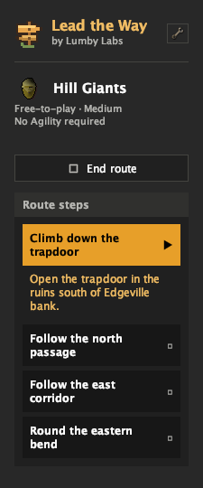
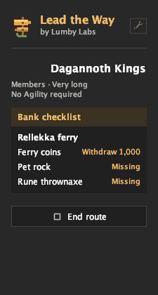

# Lead the Way

Choose a destination and follow one instruction at a time. Lead the Way marks the current waypoint on the ground, minimap and world map. A RuneLite plugin by [Lumby Labs](https://bshelton.github.io/lumby-labs/).

## Start a route

1. Open the **signpost** sidebar and search for **Hill Giants** or **Dagannoth Kings**.
2. Select the destination to see its length, requirements and steps. Open your bank to see what to withdraw for the suggested route.
3. Click **Guide me**. Follow the cyan minimap cue and the gold current step. The guide advances as you reach each area. On the Kings route, gold highlights identify the pet rock or thrownaxe in your inventory, the special attack control, and the prayer to activate. Cyan ground labels and outlines identify the pads, dropped rock, door, support and ladders.
4. Choose **End route** to clear the guide and its markers.

 

## Destinations

| Guide | Access | What to expect |
|---|---|---|
| **Hill Giants** | Free-to-play · Medium | From Edgeville, use the trapdoor south of the bank and follow the walking route around the Agility pipe. Pick up the brass key in the round room for future visits. Near the Grand Exchange, a brass key lets you use the shed west of the Cooks’ Guild. |
| **Dagannoth Kings** | Members · Very long | Follow the northern solo route through Waterbirth Dungeon to the Kings’ entrance. Bring a pet rock and rune thrownaxe for the doors, as well as your own combat supplies. |

**Which entrance or teleport?** The guide compares supported approaches using your location, inventory, equipment and relevant unlocks. With the bank open it can also suggest withdrawals. After you close the bank, directions use what you actually carry. The length label describes the standard route. Shortcuts can shorten your trip.

**How do I read the markers?** A cyan arrow points toward a distant waypoint and becomes a dot when it comes into minimap range. On the world map, look for the gold signpost. The markers point directly toward the next landmark. Use the written instruction to follow corridors and go around obstacles.

**How do I hide the banner?** Open **Settings** in the sidebar header (the wrench on narrow panels) and toggle **Show canvas helper**. You can also move the banner with RuneLite’s overlay drag hotkey, normally Alt on Windows or Option on macOS.

## Help and development

[Report a route or display issue](https://github.com/bshelton/lead-the-way/issues). Include the destination, the instruction displayed and where you were standing. For a packing issue, mention whether the item was equipped, carried or in the open bank.

See [developer notes](docs/DEVELOPMENT.md) for local setup, automated checks and route data.
